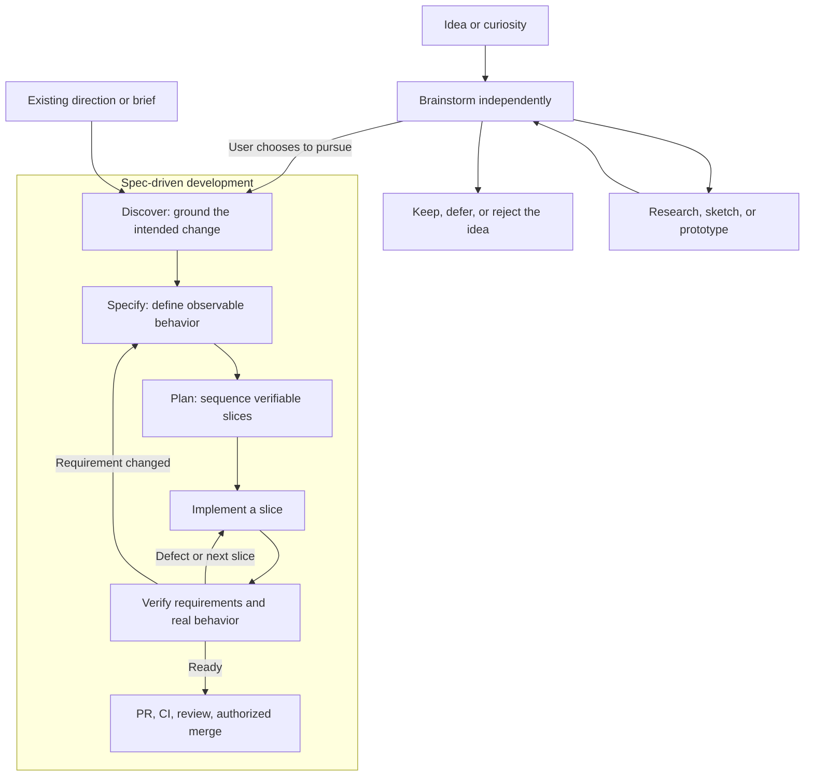

# Brainstorming and SDD workflow handoff

## Purpose and current state

Continue the design of Spellbook skills for moving from an initial concept to a
shipped pull request. This file captures the conversation's decisions and
proposals so another agent can continue without the original chat.

Status: research and workflow proposal only. No brainstorming or SDD skills have
been implemented or installed by this work. The latest request was to document
this handoff, not to implement the proposed skills or open a PR.

Read the [glossary](../GLOSSARY.md), [skill maintenance procedure](skills.md),
and [external-source guidance](external-sources.md) before implementation.

## Confirmed direction

- Brainstorming is a standalone activity outside the SDD cycle. The user may
  want to explore an idea without deciding to specify or implement anything.
- Discovery remains the first stage of SDD. It starts once the user has a
  foundation for what they want and grounds that direction in the project.
- Brainstorming can feed discovery, but it is neither a mandatory prerequisite
  nor an automatic commitment to delivery.
- The intended delivery workflow spans concept clarification through a shipped
  PR. The exact skill names, artifact conventions, and shipping policy below
  remain proposals.

An earlier suggestion merged brainstorming and discovery into one skill. The
user's latest clarification supersedes that suggestion: keep them separate.
Do not remove discovery or make brainstorming the first mandatory SDD stage.

## Workflow sketch



## Brainstorming contract

Suggested skill name: `brainstorm`.

Input can be a vague idea, frustration, opportunity, or question. Help the user
understand the problem and explore possibilities through a natural conversation.
Ask focused questions, develop alternatives, surface assumptions, and investigate
facts when doing so would clarify the discussion. Use examples and visual
sketches when they make choices easier to understand. A throwaway prototype can
be useful, but distinguish experimentation from production implementation.

Valid outcomes include a promising direction, more questions, a decision to
defer, or a decision not to build. Do not force every conversation to converge
on a specification or an implementation plan.

Keep casual outcomes in chat. When a persistent handoff is useful, produce an
idea brief containing the problem, audience, options, tradeoffs, decisions,
assumptions, unresolved questions, and research or prototype evidence. Its path
and template are not decided. It is exploratory input, not a competing spec.

Do not automatically start SDD. An existing request to take an idea through
delivery can authorize the transition; brainstorming alone does not. Preserve
the difference between user decisions and agent suggestions in the brief.

## Discovery contract

Suggested skill name: `sdd-discover`; packaging is still open.

Start from a direction the user wants to pursue, whether it came from
brainstorming, an existing brief, or the current request. Reuse settled context
instead of repeating the brainstorming interview.

Investigate the existing system, affected capabilities, domain vocabulary,
constraints, relevant prior decisions, and behavioral test seams. Identify the
scope, non-goals, risks, and unknowns that could change what is specified. Use
research or targeted experiments to answer technical questions; reserve product
and preference decisions for the user unless already delegated.

Output is a grounded brief sufficient for specification, with evidence and
remaining questions. Discovery does not need to settle every implementation
detail. If the underlying direction becomes uncertain, make that visible and
return to brainstorming when appropriate rather than inventing requirements.

## Proposed downstream skills

| Stage | Proposed responsibility | Existing resources to consider |
| --- | --- | --- |
| Specify (`sdd-specify`) | Define scope, observable behavior, failure scenarios, and acceptance conditions. | Domain modeling and glossary/ADR practices. |
| Plan (`sdd-plan`) | Divide work into vertical slices with dependencies, interfaces, risks, and verification. | Architecture and sequence-verifiable-units guidance. |
| Implement (`sdd-implement`) | Execute slices with behavioral tests and short feedback cycles; record discoveries. | Debugging and engineering principles. |
| Verify (`sdd-verify`) | Check spec coverage, code quality, regressions, and actual user-facing behavior. | Project verification skills and prove-it-works guidance. |
| Deliver | Create and maintain the PR, resolve findings, verify current evidence, and merge within authorization. | `commit`, `file-pr`, `babysit-pr`, and selected pstack shipping practices. |

A thin `sdd` entry skill could route and resume work while keeping stages
independently invokable. It should start at discovery for an ungrounded delivery
request, or at the appropriate later stage when usable artifacts already exist.
This entry skill and its routing policy are not yet approved designs.

## Proposed artifact and execution rules

Use OpenSpec's artifact model as the candidate foundation:

```text
openspec/
  specs/<capability>/spec.md
  changes/<change>/
    proposal.md
    specs/<capability>/spec.md
    design.md
    tasks.md
    evidence.md
```

`evidence.md` is a proposed local addition, not a standard OpenSpec requirement.
Whether to require the OpenSpec CLI or only use its conventions remains open.

- Keep behavior in specs, technical choices in designs, and execution details
  in tasks. Reference project conventions instead of copying them everywhere.
- Link acceptance conditions to implementation tasks and verification evidence.
  Record the revision and environment verified where relevant.
- Scale rigor to the task. A trivial change should not require the full package.
- Prefer independently verifiable vertical slices. Handle wide mechanical
  migrations deliberately instead of forcing artificial feature slices.
- Revise artifacts when learning changes the design. Do not silently change
  acceptance criteria merely to fit the implementation.
- Preserve authorization across stages. Avoid repeated confirmation for routine
  work already requested; do not infer permission to merge or deploy from a
  request to brainstorm, plan, or open a PR.
- Keep native execution available. Multiple agents and model-specific roles
  should be optional, subject to the harness and the user's instructions.
- Distinguish PR opened, merge-ready, merged, and deployed. The previous proposal
  treated “shipped PR” as merged with reconciled specs and retained evidence;
  confirm that meaning when it affects an implementation request.
- The proposed archive convention is to reconcile specs in the implementation
  PR so code and behavior land together. Post-merge archival is an alternative
  that needs an explicit owner. This choice is not settled.

## Source research to carry forward

These are research snapshots read earlier in this conversation, not provenance
records for completed skill adaptations. Reconstruct sources outside the
checkout and inspect the relevant complete skill directories before authoring.
Do not rely on temporary checkout paths from the earlier session.

| Source repository | Inspected revision | Relevant material and proposed contribution |
| --- | --- | --- |
| [Matt Pocock](https://github.com/mattpocock/skills) | `49dd158d1076134a641b33efb035946536778336` | `skills/engineering/{to-spec,to-tickets,implement-spec,implement}/SKILL.md`: synthesis, behavioral test seams, vertical slices, task dependencies. Current names differ from older PRD examples. |
| [Superpowers](https://github.com/obra/superpowers) | `bb92a77741419a4ab5f06e711a283343f1ada0c3` | `skills/{brainstorming,writing-plans,subagent-driven-development,finishing-a-development-branch}/SKILL.md`: exploratory conversation, explicit handoffs, implementation and review loops. Its “SDD” can mean subagent-driven development. |
| [OpenSpec](https://github.com/Fission-AI/OpenSpec) | `f80d860fc510ba4f51180c8ddde35b91b32de657` | `docs/{concepts,workflows,team-workflow}.md` and `schemas/spec-driven/schema.yaml`: maintained behavior specs, change deltas, iterative artifacts, archival. Artifact completion does not prove merge readiness. |
| [Addy Osmani](https://github.com/addyosmani/agent-skills) | `aeac41d4d005999432bb7312f7ff06383a91d59d` | `skills/{spec-driven-development,planning-and-task-breakdown,shipping-and-launch}/SKILL.md`: success criteria, assumptions, capability decomposition, release considerations. Explicitly permits OpenSpec artifacts instead of duplicate specs. |
| [pstack](https://github.com/cursor/plugins/tree/main/pstack) | `99743e9c151c8537cbbf1f98bb38f34ef3368453` | `pstack/README.md` explains its code-first philosophy. Local `skills/poteto-mode/` feature, multi-phase-plan, and shipping playbooks were also reviewed; consult their own provenance before updates. |

The intended ownership is **adapt**: author coherent Spellbook skills informed
by several sources. Do not mechanically combine their instructions or treat one
source's workflow as controlling all future changes. Record actual source
reviews in `SOURCE.toml` and source-specific decisions in `ADAPTATIONS.md` when
skills are authored, preserving applicable notices.

## How pstack fits

Pstack favors code, experiments, domain modeling, and demonstrated runtime
behavior; planning is available but not its default. Its execution and shipping
playbooks emphasize ownership, independent verification, and evidence that still
matches the patch being landed. It also has substantial multi-phase planning,
so do not describe it as having no planning or specifications.

The proposed SDD workflow adds a durable connection between user intent,
behavioral requirements, tasks, and evidence. Retain pstack's useful engineering
principles beneath that workflow without importing its full orchestration cost
or environment-specific assumptions into every feature. The local principle
references are already available; read their triggers before applying them.

## Next agent's work

1. Read this handoff and inspect the current skill catalog and relevant skills.
   Preserve existing user edits. Confirm what work the new request authorizes.
2. Design the standalone brainstorming skill first, including its valid stopping
   outcomes and optional idea brief. Do not implement the superseded merged
   brainstorming/discovery design.
3. Define discovery's input/output contract and how it reuses an idea brief.
   Resolve overlap with `grilling`, `grill-me`, and `grill-with-docs`; retain
   existing skills unless their replacement is intentionally in scope.
4. Resolve packaging, artifact conventions, CLI dependence, invocation policy,
   stage transitions, and delivery semantics before encoding them as requirements.
5. Implement an initial coherent increment when requested, using the applicable
   skill-authoring instructions, provenance rules, and catalog/index updates.
   Keep installation separate from source authoring.
6. Evaluate realistic requests: brainstorming with no intent to build; a known
   direction entering discovery directly; a brief handed to a fresh agent; an
   ambiguous feature; and a change spanning PRs. Check unnecessary questions,
   requirement coverage, drift, verification quality, and stopping behavior.

Do not claim runtime or cross-harness validation from document inspection alone.
No TypeScript tooling changes are required by this handoff. If later work changes
that tooling, run `npm run check` and `npm test` per repository instructions.
